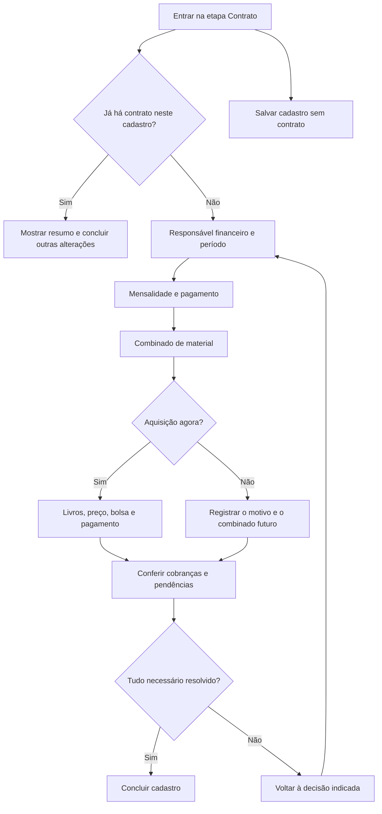

# Contrato e aquisição de material — mapa de estados

Levantamento inicial: 29/10/2026, **anterior à implementação**. Escopo confirmado: somente o
modal/etapa de criação de contrato. Reconciliação com a implementação: 29/10/2026.

**Depois:** mapear e redesenhar renovação e os estados da página do aluno. Organização de turmas
também fica fora deste recorte. Esses fluxos são referências de domínio, não entregas desta etapa.

**Como ler:** **Atual** descreve o código no levantamento inicial; **Definido** registra decisões
do usuário; **Proposta** preserva hipóteses daquele levantamento; **Em aberto** exige decisão.
Uma proposta não altera uma regra vigente. A atualização abaixo e [IMPLEMENTATION.md](IMPLEMENTATION.md)
registram o comportamento entregue; as demais tabelas preservam o contexto anterior.
O mapa cobre os ramos encontrados nos componentes e regras lidos; não substitui a validação
de todas as combinações. Os grupos abaixo são dimensões independentes: bolsa, material, pagador e vigência podem se combinar.
Não é necessário criar uma tela para cada combinação.

## Atualização após implementação

- O usuário escolheu **Resumo ao lado**: resumo à esquerda e campos à direita, com prioridade
  para desktop. O produto agora tem quatro assuntos: responsável e período, mensalidades,
  material didático e conferência. Datas e valores usam grupos compactos; o rodapé mantém uma ação primária.
- A prévia de mensalidades independe de pagador ou material incompletos. Livros aparecem antes
  do pagamento, e a cotação conta apenas livros selecionados. No cadastro, o estágio sugerido pode
  preencher a aquisição ao ativá-la, quando disponível no catálogo e sem livros já escolhidos.
- A cópia de aluno ou responsável usa Tooltip do design system e mantém o ícone após seleção
  compacta. Dica automática: 650 ms de espera, 4,5 s visível e intervalo de 30 min por origem
  na sessão; hover continua disponível.
- O cadastro delega a validação do aluno ao fluxo pai (`deferStudentValidation`); o modal avulso
  expõe nascimento e documento do responsável exigidos pelo validador.
- Erros abrem blocos recolhíveis antes do foco; erros de pagador expandem a seleção copiada
  compacta e a edição mantém seus campos abertos. A revisão final e a evidência desktop da bolsa
  estão em [IMPLEMENTATION.md](IMPLEMENTATION.md), com os limites da reprodução do caso de pagador.
- **Aquisição futura, motivos de não aquisição e cobertura externa continuam propostas sem
  persistência neste fluxo.** A composição aceita não implementa essas políticas.
- Houve inspeção dos fluxos reais no Orca. A captura estreita de 390 CSS px é complementar ao
  foco desktop; os cenários exercitados e limites estão em [IMPLEMENTATION.md](IMPLEMENTATION.md).

## 1. Limites já definidos

- Mudança de turma e mudança de estágio são acontecimentos pedagógicos. Podem ocorrer várias
  vezes durante o mesmo contrato.
- Rematrícula é a renovação dos termos financeiros ao término de sua vigência. É gratuita.
- Taxa de matrícula inicial é opcional, informada livremente naquele contrato; não há taxa global.
- O combinado de aquisição de material precisa aparecer no início, na etapa Contrato do cadastro.
- Adquirir materiais de vários estágios agora e adquirir um por vez são escolhas diferentes.
  O parcelamento de uma aquisição é outra decisão.
- Na mudança pedagógica, a questão financeira a resolver é a necessidade de material e o seu
  histórico. A mudança não cria renovação de contrato nem uma aquisição automaticamente.
- Material é tratado como repasse e não compõe faturamento da escola. Despesas e lucro ficam
  para um trabalho posterior.
- A prioridade é a etapa Contrato. Levar organização para dentro de Turmas é uma etapa posterior.

## 2. Entradas e saídas do fluxo

| Entrada                              | Contexto conhecido                                          | O que precisa resolver                                                      | Saída atual                                                                              |
| ------------------------------------ | ----------------------------------------------------------- | --------------------------------------------------------------------------- | ---------------------------------------------------------------------------------------- |
| Cadastro novo → Contrato             | Aluno, endereço e situação pedagógica das etapas anteriores | Pagador, vigência, mensalidade, condições de pagamento e eventual aquisição | Cadastro concluído, com cobranças; pode haver pendência pedagógica explicitamente aceita |
| Retomar cadastro sem contrato        | Aluno já salvo; turma pode estar pendente ou definida       | Os mesmos termos financeiros                                                | Completa o cadastro; os termos de um rascunho anterior não são recuperados               |
| Retomar cadastro com contrato        | Já existe contrato retornado pelas pendências               | Salvar alterações das outras etapas                                         | Exibe aviso de contrato cadastrado; não cria outro                                       |
| Novo contrato pelo financeiro/perfil | Aluno pode vir selecionado ou precisar ser escolhido        | Mesmo formulário; também permite cadastrar aluno e pagador dentro dele      | Cria contrato, pessoas novas e cobranças na mesma operação                               |

**Atual:** criar contrato/aquisição registra o compromisso e suas cobranças. Não registra um
pagamento realizado. Comprovante e nome de terceiro pertencem ao registro do recebimento.

**Atual:** os comandos financeiros de contrato e aquisição exigem acesso administrativo.

## 3. Mapa resumido proposto

O ramo de combinado futuro e a distinção dos motivos sem aquisição são **propostas**; hoje não
existem como dados estruturados. “Salvar sem contrato” é uma saída secundária do cadastro,
disponível sem concluir as subetapas financeiras.

## 4. Estados de preenchimento atuais

### 4.1 Aluno e responsável financeiro

| Estado                                                    | Campos/ações visíveis                                    | Obrigatoriedade e efeito atual                                                                                                          |
| --------------------------------------------------------- | -------------------------------------------------------- | --------------------------------------------------------------------------------------------------------------------------------------- |
| Aluno vindo do cadastro                                   | Identidade já preenchida nas etapas anteriores           | Não deve pedir a identidade novamente                                                                                                   |
| Aluno existente no modal financeiro                       | Busca, carregando, sem resultados, falha ou seleção      | Selecionar um aluno válido                                                                                                              |
| Aluno com contrato anterior/atual escolhido no financeiro | Continua no formulário de novo contrato                  | A criação avulsa não identifica automaticamente uma renovação nem impede sobreposição de vigência; não inventar essa regra no redesenho |
| Aluno novo no modal financeiro                            | Nome, documento, telefone, e-mail; adicionar responsável | Nome obrigatório. Documento e contatos opcionais; documento preenchido precisa de tipo                                                  |
| Responsável do aluno adicionado                           | Nome, telefone, e-mail                                   | Nome obrigatório quando adicionado; o cadastro completo exige contato do responsável para menor                                         |
| Pagador não escolhido                                     | Busca e atalho de cópia                                  | Impede criar contrato, inclusive com bolsa integral                                                                                     |
| Pagador existente                                         | Pessoa selecionada; opção de limpar/trocar               | Não recria a pessoa                                                                                                                     |
| Novo pagador                                              | Nome, documento, telefone e e-mail                       | Nome obrigatório; documento e contatos opcionais; pessoa é criada ao salvar                                                             |
| Copiar aluno ou responsável                               | Atalho junto à busca                                     | Prefere o responsável quando informado; copia os dados para um **novo** pagador                                                         |
| Cópia com todos os dados                                  | Nome resumido na seleção                                 | Esconde os campos de cadastro; não significa vínculo com um pagador existente                                                           |
| Limpar pagador                                            | Retorna à busca                                          | Limpa os dados desse pagador no formulário                                                                                              |

**Atenção de desenho:** responsável pelo aluno, responsável financeiro e terceiro que fez um Pix
são papéis distintos. O terceiro não deve abrir um novo cadastro de pagador neste fluxo.

### 4.2 Condições carregadas

| Estado                         | Comportamento atual          | Consequência para o redesenho                                   |
| ------------------------------ | ---------------------------- | --------------------------------------------------------------- |
| Carregando condições da escola | Mensagem de carregamento     | Não sugerir valor zero nem permitir concluir sem termos válidos |
| Falha de carregamento          | Tentar novamente             | Preservar o preenchimento                                       |
| Condições não configuradas     | Aviso; criação indisponível  | No cadastro, ainda é possível salvar sem contrato               |
| Condições disponíveis          | Sugere mensalidade pelo teto | Manter valores já editados pelo usuário                         |

### 4.3 Vigência e datas

| Decisão            | Atual                         | Dependências/subestados                                                          |
| ------------------ | ----------------------------- | -------------------------------------------------------------------------------- |
| Data do acordo     | Sugere hoje                   | Também é o vencimento da taxa de matrícula quando houver                         |
| Início da vigência | Campo obrigatório             | No contrato inicial, o mesmo valor é enviado como primeiro vencimento            |
| Fim da vigência    | Sugere 12 meses após o início | Deixa de atualizar automaticamente após edição manual                            |
| Duração            | Derivada das datas            | Deve representar de 1 a 120 meses completos; trata o último dia de meses menores |

**Lacuna:** a API distingue início e vencimento, mas o formulário inicial os une. O redesenho deve esclarecer essa relação no modal atual; a análise específica da
renovação fica para depois.

### 4.4 Mensalidade, bolsa e taxa inicial

| Estado                     | O que aparece                                   | Regra atual                                                                                 |
| -------------------------- | ----------------------------------------------- | ------------------------------------------------------------------------------------------- |
| Sem bolsa                  | Mensalidade acordada                            | Valor positivo dentro do piso/teto; desconto de pontualidade da escola pode ser aplicado    |
| Bolsa parcial              | Mensalidade antes da bolsa, percentual e acordo | Percentual maior que 0 e menor que 100; acordo obrigatório; não acumula pontualidade        |
| Bolsa integral             | Mensalidade de referência, 100% e acordo        | Mantém vigência e termos; não gera cobrança de mensalidade                                  |
| Percentual inválido        | Erro na bolsa                                   | Limite de 0 a 100, até quatro casas decimais; bolsa parcial precisa deixar ao menos R$ 0,01 |
| Voltar a 0%/vazio          | Recolhe o acordo da bolsa                       | O acordo deixa de ir no envio; rascunho local pode permanecer para reativação               |
| Taxa inicial vazia ou zero | Campo opcional                                  | Não gera cobrança de matrícula                                                              |
| Taxa inicial positiva      | Valor informado livremente                      | Gera uma cobrança separada na data do acordo                                                |

**Atual:** mesmo com bolsa integral, a mensalidade de referência precisa ser válida. Bolsa de
mensalidade não concede automaticamente bolsa de material nem isenta a taxa inicial.

**Atual:** juros, pontualidade, limites e multa rescisória aparecem em detalhes recolhidos.
São copiados para o contrato; não são campos livres deste formulário. Renovação tem regras
próprias e será analisada na próxima etapa.

### 4.5 Pagamento das mensalidades

| Estado                | Campos                            | Resultado atual                                                         |
| --------------------- | --------------------------------- | ----------------------------------------------------------------------- |
| Plano comum           | Sem configuração adicional        | Uma parcela mensal por mês de duração                                   |
| Parcelamento avançado | Quantidade de parcelas            | De 1 até a duração em meses; redistribui o mesmo total                  |
| Uma parcela           | Quantidade 1                      | Cobra todo o valor contratado no primeiro vencimento                    |
| Divisão com centavos  | Prévia com valores variáveis      | Total permanece exato; parcelas não precisam ser idênticas              |
| Quantidade inválida   | Erro no campo                     | Vazio, fração, zero ou acima da duração impedem concluir                |
| Bolsa integral        | Controles de parcelamento ocultos | Nenhuma parcela de mensalidade; material/taxa podem continuar existindo |

**Atual:** parcelas são mensais a partir do primeiro vencimento. Não há edição de cada data,
entrada separada ou parcelas irregulares neste formulário. Esses recursos não são pressupostos
do redesenho.

### 4.6 Material: aquisição, cobertura e pagamento

Há quatro perguntas independentes:

1. **Qual material o aluno precisa?** Depende do estágio e da trajetória prevista.
2. **O que já foi adquirido?** Cobertura por livro/estágio, inclusive de aquisições anteriores.
3. **O que será adquirido agora e o que fica para depois?** Combinado de aquisição.
4. **Como pagar esta aquisição?** À vista ou no cartão, com os termos aplicáveis.

| Estado atual                      | Campos/efeito                                       | Limite encontrado                                                                        |
| --------------------------------- | --------------------------------------------------- | ---------------------------------------------------------------------------------------- |
| Sem nova aquisição                | Oculta os detalhes; não cria aquisição              | Não distingue já adquirido, adquirir depois ou decisão ainda pendente                    |
| Nova aquisição à vista            | Livros, faixa de preço, bolsa e valor               | Uma cobrança da aquisição; selecionar à vista não registra pagamento realizado           |
| Nova aquisição no cartão          | Mesmos livros, faixa, bolsa, parcelas e taxa        | Parcelas no cartão do aluno; para a escola, uma cobrança pelo líquido                    |
| Um ou vários livros               | Uma linha por estágio; incluir/remover livro        | Abre com duas linhas vazias; mínimo um; não permite duplicar estágio dentro da aquisição |
| Faixa Infantil/Adulto             | Seleção manual de preço                             | O catálogo conhece faixa por trilha, mas não a preenche automaticamente aqui             |
| Livros de faixas diferentes       | Uma única faixa para a aquisição inteira            | Tratamento de cesta mista não resolvido pela UI atual                                    |
| Sem bolsa de material             | Preço da tabela                                     | Independente da bolsa de mensalidade                                                     |
| Bolsa parcial de material         | Percentual e acordo obrigatório                     | Aplica-se a todos os livros desta aquisição                                              |
| Bolsa integral de material        | Acordo; valor final zero                            | Registra aquisição sem cobrança; ainda exige livros e cotação válidos                    |
| Preço carregando/indisponível     | Carregamento, tentar novamente ou configurar preços | Não é aquisição gratuita; impede confirmar uma aquisição com preço desconhecido          |
| Catálogo carregando/falhou/vazio  | Carregamento, erro ou lista vazia                   | Sem livros válidos não há aquisição confirmável                                          |
| Preço mudou durante preenchimento | Servidor rejeita a cotação antiga                   | Exige conferir a cotação atualizada antes de tentar salvar novamente                     |

**Atual:** preço e número de parcelas vêm da configuração por faixa. O número de parcelas
no cartão cresce com a quantidade de livros. Não há negociação livre desses valores no formulário.
O modelo guarda livros, preço cotado, condição de pagamento, bolsa, taxa e valor final.

**Atual:** uma aquisição registrada conta como material adquirido mesmo que o recebimento esteja
pendente. O lembrete consulta aquisições anteriores do aluno, inclusive em outros contratos.
Não há prevenção geral de recomprar o mesmo estágio em outra aquisição; a proibição de duplicata
vale apenas dentro de uma aquisição.

**Atual:** a seção de material deste modal não recebe automaticamente o estágio escolhido na
etapa pedagógica. Há contexto disponível no cadastro, mas a sugestão de livro ainda precisa
ser conectada; um esboço com livro sugerido não prova que isso já funciona.

**Atual:** o lembrete acadêmico surge nos últimos 30 dias do fim planejado do estágio ou depois
dele. No PPT sugere o próximo estágio da trilha; no regular usa o destino definido na organização.
Não gera cobrança nem renova contrato.

### 4.7 Resumo e conclusão

| Estado                     | Atual                                                             | Necessidade do desenho                                                              |
| -------------------------- | ----------------------------------------------------------------- | ----------------------------------------------------------------------------------- |
| Preenchimento incompleto   | Prévia geral desaparece quando qualquer parte do input é inválida | Mostrar resumos parciais e apontar qual decisão falta                               |
| Prévia válida              | Vigência, total de mensalidades, parcelas e vencimentos           | Separar informação essencial dos detalhes dos cálculos                              |
| Material ou taxa presentes | Mostra total somado a receber pela escola                         | Identificar mensalidades, matrícula e repasse de material separadamente             |
| Calendário de cobranças    | Mostra mensalidade e material quando pertinente                   | Hoje taxa de matrícula é texto fora do calendário; conferência precisa contemplá-la |
| Erro de campo              | Erro local, foco no primeiro campo inválido em parte dos fluxos   | Se houver subetapas, abrir a correta e focar o campo                                |
| Enviando                   | Evita submissão repetida e desabilita controles em vários fluxos  | Garantir o mesmo bloqueio de saída e edição em todas as entradas                    |
| Erro de servidor/rede      | Mantém valores no formulário                                      | Explicar o problema sem reiniciar; preço desatualizado é diferente de falha de rede |
| Sucesso                    | Fecha e atualiza as consultas relevantes                          | Informar o que foi criado e eventuais pendências, sem sugerir pagamento já recebido |

**Atual:** criação de contrato é transacional e tem identidade de comando para evitar repetição
da mesma operação. A UX de resultado incerto deve preservar essa proteção, não mandar criar tudo de novo.

### 4.8 Voltar, fechar, salvar parcialmente e retomar

| Ação                                 | Atual                                                                     | Risco a resolver                                                         |
| ------------------------------------ | ------------------------------------------------------------------------- | ------------------------------------------------------------------------ |
| Voltar dentro do cadastro            | Mantém o estado enquanto o diálogo está montado                           | Alterar aluno/estágio pode deixar sugestões e cópias financeiras antigas |
| Fechar cadastro com mudanças         | Tenta preparar salvamento sem contrato; abre confirmação ou descarte      | Fechar pode iniciar uma decisão adicional em vez de simplesmente sair    |
| Salvar sem contrato                  | Salva aluno e informações permitidas, mediante confirmação das pendências | **Não salva os dados financeiros preenchidos**                           |
| Fechar novo contrato pelo financeiro | Reseta o formulário                                                       | Não oferece o mesmo aviso de perda do cadastro                           |
| Retomar aluno salvo sem contrato     | Recupera aluno e contexto disponível                                      | Termos financeiros voltam a ser preenchidos                              |
| Trocar opção e voltar                | Vários ramos mantêm valores ocultos localmente                            | Preservar rascunho útil, mas excluir valores de ramos inativos do envio  |

**Em aberto:** retomar rascunho financeiro após fechar será requisito? Exige persistência própria;
não pode ser prometido apenas ao dividir o formulário em etapas.

**Fronteira:** “Dados continuam em rascunho” após um erro significa estado do formulário aberto;
não comprova recuperação após recarregar a página ou encerrar a sessão.

## 5. Estados que o novo combinado de material precisa distinguir

Estes são **propostos**, derivados do que o usuário definiu; os nomes não são um enum aprovado.

| Situação                              | O que registrar/mostrar                                      | Efeito financeiro esperado                                                      |
| ------------------------------------- | ------------------------------------------------------------ | ------------------------------------------------------------------------------- |
| Adquirir só o material atual          | Livro atual + termos desta aquisição; combinado dos próximos | Cobrar somente esta aquisição                                                   |
| Adquirir vários agora                 | Livros/estágios escolhidos + termos da aquisição             | Uma aquisição cobrindo os livros escolhidos, à vista ou no cartão               |
| Já adquirido pela escola              | Vínculo com aquisição anterior e seus termos/saldo           | Não cobrar de novo                                                              |
| Já tem, adquirido fora da escola      | Identificação do material e declaração de posse              | **Em aberto:** se permitido, registrar cobertura sem simular venda ou pagamento |
| Adquirir os próximos conforme avançar | Critério acordado, com o que já está coberto                 | Não criar cobranças futuras sem nova aquisição confirmada                       |
| Material ainda a definir              | Motivo/pendência visível                                     | **Em aberto:** se permite concluir contrato; recomendação: pendência explícita  |
| Não precisa de nova aquisição         | Motivo concreto, como mesmo livro já coberto                 | Não gerar cobrança nem exigir decisão de pagamento                              |

“Adquirido”, “quitado” e “entregue” não são sinônimos. Hoje o fluxo registra aquisição e cobrança;
entrega física não foi encontrada neste escopo. Não acrescentar logística de entrega para resolver
este formulário.

Também há dois sentidos de “repasse”: recebimento líquido da operadora de cartão e dinheiro do
material que não é receita da escola. A UI deve nomear cada um; o segundo ainda não define um
fluxo de saída/pagamento a fornecedor.

## 6. Dependências ao alterar decisões

| Mudança                               | Reavaliar                                                         | Preservar                                                                                          |
| ------------------------------------- | ----------------------------------------------------------------- | -------------------------------------------------------------------------------------------------- |
| Aluno/lead                            | Pagador copiado, cobertura anterior de material, estágio sugerido | Valores comerciais digitados até confirmar a troca; não atribuí-los silenciosamente a outra pessoa |
| Responsável financeiro                | Identidade de quem assume as cobranças                            | Livros, vigência e preços; o responsável pedagógico permanece independente                         |
| Início/fim                            | Duração, quantidade máxima de parcelas e calendário               | Edição manual do outro campo; sinalizar incompatibilidade                                          |
| Mensalidade/bolsa                     | Total, valor das parcelas e pontualidade                          | Material e sua bolsa independente                                                                  |
| Bolsa parcial → integral              | Remover cobranças de mensalidade da prévia/envio                  | Vigência, referência de preço, material e taxa aplicável                                           |
| Integral → parcial/sem bolsa          | Revalidar parcelamento antes de reativá-lo                        | Texto do acordo enquanto rascunho, com envio só se aplicável                                       |
| Estágio na etapa pedagógica           | Material necessário, sugestões e cobertura                        | Aquisições já confirmadas; nunca trocar livros comprados silenciosamente                           |
| Livros/quantidade/faixa               | Cotação, parcelas de cartão, total e bolsa                        | Pagador e termos de mensalidade                                                                    |
| À vista ↔ cartão                      | Cobrança ao aluno, taxa e líquido a receber                       | Livros e acordo de bolsa                                                                           |
| Aquisição agora → depois/já adquirido | Excluir nova aquisição das cobranças finais                       | Combinado futuro e referência ao histórico                                                         |
| Tabela de preços atualizada           | Exibir novo valor e pedir nova conferência                        | Todas as escolhas ainda válidas                                                                    |
| Voltar a uma subetapa                 | Marcar resumos dependentes como precisando de revisão             | Dados digitados e posição de navegação                                                             |

Esta tabela é o comportamento **proposto** para o redesenho. Não afirma que as invalidações já
estão implementadas.

## 7. Quando pode concluir

### Contrato inicial completo

- Aluno e responsável financeiro identificados.
- Vigência e mensalidade de referência válidas; acordo de bolsa, se houver.
- Calendário de mensalidades resolvido ou bolsa integral explícita.
- Taxa inicial ausente/zero ou valor e vencimento visíveis.
- Para cada aquisição agora: livros válidos, preço atualizado, condição de pagamento e acordo de
  bolsa quando aplicável. Combinado futuro não se transforma em cobrança por si só.
- Resumo separa mensalidades, matrícula e repasse de material; distingue cobrança criada de valor recebido.
- Pendências permitidas são apresentadas concretamente. A decisão sobre material a definir ainda está aberta.

## 8. Problemas concretos que motivam o redesenho

1. O mesmo componente serve a cadastro, contrato avulso e renovação, expondo decisões redundantes.
   A nova composição precisa ser isolada para preservar as telas que serão tratadas depois.
2. A prévia financeira depende da validade do formulário inteiro: um livro vazio pode esconder o
   resumo de mensalidades que já está correto.
3. O formulário de material começa pelo pagamento, antes de esclarecer o que comprar.
4. Duas linhas vazias de livro e faixa manual aumentam decisões sem usar o contexto pedagógico.
5. “Sem nova aquisição” apaga a distinção entre cobertura, adiamento e pendência.
6. A bolsa de mensalidade muda de coluna quando material é ativado no cadastro; a localização do
   controle depende de outra decisão.
7. Vigência e primeiro vencimento estão unidos no contrato inicial e separados na renovação.
8. “Salvar sem contrato” não guarda o rascunho financeiro; os fluxos têm comportamentos de saída diferentes.
9. Na aquisição junto do contrato, o recebimento do material acompanha o primeiro vencimento;
   não é possível negociar sua data nesta tela.
10. A escola recebe uma cobrança de material; parcelas no cartão são os termos do aluno. São
    números diferentes e hoje ficam próximos, com vocabulário que favorece confusão.
11. O total do formulário soma material; a visão geral de caixa agrega recebimentos. Esse total
    não pode ser apresentado como faturamento. Fechamentos de contratos já usam apenas mensalidades.
12. Há base para consultar cobertura e histórico; falta conectá-la às decisões de preenchimento.

## 9. Subetapas e escolha de composição

**Proposta do levantamento inicial.** Os quatro assuntos foram adotados; cobertura anterior e
combinado futuro de material nas linhas abaixo permanecem propostas de produto.

| Subetapa                 | Decisão principal                 | Campos condicionais                                               | Critério para avançar                                     |
| ------------------------ | --------------------------------- | ----------------------------------------------------------------- | --------------------------------------------------------- |
| 1. Responsável e período | Quem assume e por quanto tempo    | Seleção de aluno no financeiro; novo pagador/cópia                | Pessoa e datas válidas                                    |
| 2. Mensalidades          | Quanto e quando pagar pelo ensino | Bolsa e acordo; taxa inicial; quantidade alternativa de parcelas  | Resumo de mensalidades válido                             |
| 3. Material              | O que adquirir agora e depois     | Livros, cobertura anterior, preço, bolsa e pagamento da aquisição | Aquisição resolvida ou pendência explicitamente permitida |
| 4. Conferir              | Validar o combinado completo      | Calendários e condições anteriores sob demanda                    | Uma ação final de conclusão                               |

O pagamento fica junto do objeto ao qual se refere: mensalidade na subetapa 2, material na 3.
Assim, escolher à vista/cartão não exige ir a uma etapa distante e voltar aos livros.

Dentro do cadastro, Aluno → Endereço → Pedagógico → Contrato continua sendo o percurso principal.
As subetapas são internas a Contrato, sem abrir um segundo modal. Identidade já conhecida entra
como contexto compacto. O desenho da aquisição avulsa fica para o trabalho posterior na página do aluno.

Três composições foram exploradas com `impeccable craft`: etapas curtas, preenchimento com resumo
ao lado e acordo editável por trecho. Em 29/10/2026, o usuário escolheu **Resumo ao lado**, com
resumo à esquerda e campos à direita. Essa composição está implementada no modal real.
Protótipos adicionais dependem de pedido explícito; desktop é a prioridade.

## 10. Decisões abertas, em ordem de impacto

| Decisão                                          | Recomendação para avaliar                                                  | Alternativa/custo                                                                |
| ------------------------------------------------ | -------------------------------------------------------------------------- | -------------------------------------------------------------------------------- |
| Aquisição futura segue avanço real ou data fixa? | Registrar “conforme avançar de estágio”; data só quando de fato combinada  | Calendário fixo pode antecipar aquisição sem necessidade, especialmente no PPT   |
| Preço dos próximos livros é combinado agora?     | Cotar a aquisição quando for feita; guardar o combinado atual              | Garantia futura de preço exige registrar esse compromisso e suas condições       |
| Contrato pode concluir com material a definir?   | Sim, com pendência explícita e caminho de retorno                          | Exigir resolução impede finalizar um contrato financeiramente pronto             |
| Aceitar material adquirido fora da escola?       | Prever cobertura sem nova cobrança, se isso fizer parte da operação        | Sem esse caso, “já tem” só pode vir de aquisição registrada na escola            |
| Datas do material independentes da mensalidade?  | Avaliar uma data própria no modal, sem mudar silenciosamente a regra atual | Manter vínculo reduz flexibilidade; mudar exige ajustar o envio e a regra da API |
| Cartão: parcelas fixas da tabela ou negociáveis? | Preservar regra atual no primeiro redesenho e tornar o resultado claro     | Quantidade negociável exige nova regra de cotação e taxa                         |
| Cesta com livros de faixas diferentes?           | Sugerir faixa por livro; esclarecer como cotar antes de implementar        | Separar em aquisições por faixa é alternativa menor                              |
| Guardar rascunho financeiro entre sessões?       | Decidir explicitamente; não prometer recuperação que não existe            | Persistência amplia o primeiro recorte, embora melhore interrupções reais        |

## 11. Cenários para comparar qualquer alternativa visual

| Cenário                                                            | O que a experiência deve demonstrar                                           |
| ------------------------------------------------------------------ | ----------------------------------------------------------------------------- |
| Aluno novo, pagador existente, mensalidade comum, um livro à vista | Caminho curto e uma conclusão clara                                           |
| Responsável assume pagamento, com dados incompletos                | Copiar/revisar sem exigir contatos opcionais                                  |
| Contrato de 24 meses, quatro livros adquiridos agora               | Quantidade de livros independente de duração e parcelamento                   |
| Quatro livros agora no cartão                                      | Total do aluno, parcelas do cartão e líquido da escola compreensíveis         |
| Um livro agora e próximos conforme avanço                          | Combinado futuro visível, sem cobranças inventadas                            |
| Mensalidade com bolsa parcial, material sem bolsa                  | Acordos e valores independentes                                               |
| Mensalidade integral, material pago                                | Contrato sem mensalidades e material com cobrança                             |
| Material integral, mensalidade paga                                | Aquisição registrada sem cobrança de material                                 |
| Ambas as bolsas integrais                                          | Vigência e acordos registrados sem parcelas desses itens                      |
| Taxa inicial com material e mensalidade                            | Todos os valores e vencimentos aparecem na conferência                        |
| Material já adquirido, ainda não quitado                           | Mostra cobertura e saldo; evita recompra por confundir aquisição com quitação |
| Material comprado em outro contrato                                | Reaproveita cobertura/histórico do aluno                                      |
| Cadastro retomado que já tem contrato                              | Não duplica contrato                                                          |
| Sem estágio definido                                               | Não obriga escolher livros arbitrariamente; explicita a decisão pendente      |
| Voltar e trocar estágio depois de escolher livros                  | Mostra o impacto e preserva o trabalho que continua válido                    |
| Tabela muda antes de concluir                                      | Revisa preço sem perder as outras escolhas                                    |
| Falha de rede ao concluir e nova tentativa                         | Evita duplicidade e preserva preenchimento                                    |
| Sair no meio e retomar                                             | Explica com precisão o que fica salvo                                         |

## 12. Evidência e limites do levantamento inicial

O mapa inicial foi obtido por leitura de UI, validadores, regras, persistência e consultas.
Naquele momento, abrir o modal financeiro no Orca confirmou o estado inicial e datas nativas;
o cadastro já usava datas mascaradas. Essa inspeção antecedeu a escolha e a implementação.
As entradas de criação agora usam a composição com datas mascaradas e foram exercitadas no
produto conforme [IMPLEMENTATION.md](IMPLEMENTATION.md). As evidências não homologam todas
as combinações, persistência final ou dispositivo móvel nativo. Renovação e página do aluno
continuam fora do escopo. Sem lint, typecheck, build, testes ou diff-check, conforme instrução do usuário.

Fontes principais:

- [Entrada do cadastro](../../apps/web/src/features/students/new-student/new-student-view.tsx),
  [etapa Contrato](../../apps/web/src/features/students/new-student/intake-contract.tsx),
  [salvamento e pendências](../../apps/web/src/features/students/new-student/new-student-save.ts).
- [Modal financeiro](../../apps/web/src/features/contracts/contracts-page.tsx),
  [estado e validação](../../apps/web/src/features/contracts/new-contract-state.ts),
  [conversão do formulário](../../apps/web/src/features/contracts/contract-form-model.ts).
- [Responsável financeiro](../../apps/web/src/features/contracts/contract-payer-fields.tsx),
  [condições](../../apps/web/src/features/contracts/contract-form-fields.tsx),
  [bolsas](../../apps/web/src/features/contracts/contract-scholarship-fields.tsx).
- [Material](../../apps/web/src/features/contracts/contract-material-section.tsx),
  [aquisição adicional](../../apps/web/src/features/contracts/add-contract-material.tsx),
  [prévia de pagamento](../../apps/web/src/features/contracts/contract-payment-section.tsx).
- [Renovação](../../apps/web/src/features/class-organization/renewal-model.ts),
  [pré-condições de renovação](../../packages/api/src/finance/internal/renewal.ts).
- [Validação de contratos](../../packages/validators/src/contracts.ts),
  [mensalidades](../../packages/domain/src/monthly-contract.ts),
  [cotação](../../packages/domain/src/material-pricing.ts).
- [Persistência de contratos](../../packages/api/src/finance/internal/contracts.ts),
  [persistência de material](../../packages/api/src/finance/internal/contract-materials.ts),
  [cobertura e necessidade](../../packages/api/src/finance/internal/material-needs.ts),
  [lembrete](../../packages/domain/src/material-reminder.ts).
- [Caixa agregado](../../packages/api/src/finance/internal/analytics.ts),
  [fechamentos comerciais](../../packages/api/src/finance/internal/contract-closings.ts),
  [modelo persistido](../../packages/db/prisma/schema.prisma).
- [Calendários separados](../../docs/decisions/0005-separate-academic-and-commercial-calendars.md),
  [vínculo e estágio separados](../../docs/decisions/0009-separate-enrollment-from-pedagogical-placement.md).
