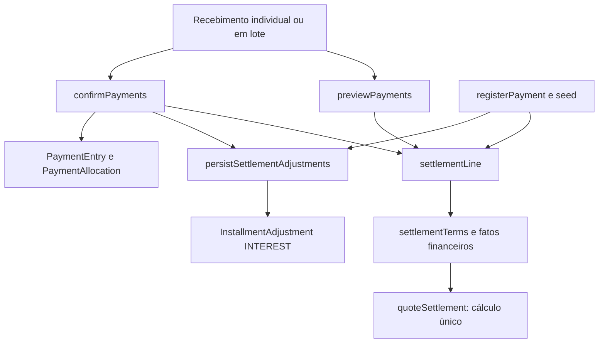

# Juros: mapa completo para simplificação

Data: 29/10/2026. Estado: implementação concluída; testes direcionados aprovados; validação visual bloqueada pelo runtime Orca. O inventário abaixo registra a situação anterior e o alcance da mudança.

## Decisões do usuário

- Um único juro: **2% ao mês, fracionado diariamente**.
- Sistema em pré-produção: **sem compatibilidade com a regra anterior**.
- Remover o cálculo diário + aniversário mensal, o fallback legado de 1% e os contratos de API que exigem duas taxas.
- Mapeamento e implementação autorizados; recriação dos dados de desenvolvimento autorizada em 29/10/2026.

## Regra de destino

Convenção aceita: mês de **30 dias**, portanto `juros = principal pendente × 0,02 × dias / 30`.
A taxa mensal permanece configurável nos Ajustes, com padrão de 2%, e é copiada para o contrato.
A migração normaliza configurações e contratos existentes para 2%; renovação conserva esse snapshot.

- Não armazenar uma segunda taxa diária de 0,0667%: ela é derivada e seu arredondamento perde precisão.
- Juros simples, sem capitalizar encargos; pagamentos parciais reduzem o principal depois da alocação aos encargos.
- Vencimento sem atraso: zero. Datas de negócio em America/Sao_Paulo.
- Acumular frações de centavo ao longo dos períodos; arredondar o total monetário, não cada dia.
- Manter o registro de juros efetivamente aplicados como `InstallmentAdjustment.INTEREST`.
  Esse registro é um fato financeiro, não uma segunda modalidade de juros.
- Simulação não grava; confirmação aplica apenas a diferença ainda não lançada.
- Suspensão, perdão de encargos e correção de principal continuam sendo fatos distintos.

Exemplo, principal constante de R$ 1.000: 1 dia = R$ 0,67; 15 dias = R$ 10;
30 dias = R$ 20; 45 dias = R$ 30; 60 dias = R$ 40.

## O que existe hoje

| Caminho                               | Regra atual                                                                       | Consequência                                       |
| ------------------------------------- | --------------------------------------------------------------------------------- | -------------------------------------------------- |
| Recebimento de mensalidade contratual | Taxa diária × dias **mais** taxa mensal × aniversários completos do vencimento    | Dois juros cumulativos                             |
| Prévia legada                         | Taxa fixa de 1% × dias / 30, com `Math.floor`                                     | Outra taxa, outro arredondamento e outra base      |
| Listas e indicadores de saldo lançado | Nominal + ajustes registrados − pagamentos                                        | Não são uma cotação de quitação atualizada         |
| Renovação                             | Reutiliza as taxas do contrato anterior                                           | Apenas mudar Ajustes não elimina a regra antiga    |
| Material                              | Sem juros automáticos                                                             | Preservar o tratamento como repasse                |
| Taxa de matrícula                     | Sem juros automáticos no calculador atual, que só usa taxas para `TUITION`        | Não ampliar a cobrança implicitamente              |
| Acerto da rescisão                    | Gera ordem `OTHER`, sem contrato associado e sem juros automáticos no recebimento | Não confundir encargos da rescisão com juros novos |

**Precisão sobre a prévia:** `ledger-read.ts` só fornece 1% a ordens não materiais **sem contrato**;
contratos recebem taxa zero nessa projeção. `student-balances.ts` calcula a projeção, mas soma somente
`collectibleRemainingCents`. Não há evidência de que toda tela hoje mostre juros de 1%.

## 1. Cálculo de domínio

| Arquivo                                        | Responsabilidade atual                                                                                                                      | Mudança proposta                                                                                                                         |
| ---------------------------------------------- | ------------------------------------------------------------------------------------------------------------------------------------------- | ---------------------------------------------------------------------------------------------------------------------------------------- |
| `packages/domain/src/payment-settlement.ts`    | `InterestTerms` tem `dailyPct` e `monthlyPct`; `accrueInterest` conta dias e aniversários; dois acumuladores `bigint`, dois arredondamentos | Um acumulador e proporcionalidade diária da taxa mensal; retirar o laço de aniversários e a taxa diária                                  |
| `packages/domain/src/finance-ledger.ts`        | `deriveInterestPreviewCents` usa saldo atual, taxa recebida e dias/30; arredonda para baixo                                                 | Retirar a calculadora paralela e `interestPreviewCents` se o campo não tiver consumidor útil; deixar o ledger representar fatos lançados |
| `packages/domain/src/contract-status.ts`       | Chama ledger com taxa zero para estados e progresso                                                                                         | Remover o parâmetro de taxa se retirado do ledger; preservar semântica de saldo registrado                                               |
| `packages/domain/src/receivables-dashboard.ts` | Agrega `collectibleRemainingCents`, não soma a prévia de juros                                                                              | Não transformar indicadores em cotação implicitamente                                                                                    |
| `packages/domain/src/index.ts`                 | Exporta calculadores e tipos públicos                                                                                                       | Ajustar os tipos removidos e a interface única                                                                                           |

Não basta trocar os percentuais: a prévia legada não recebe datas dos pagamentos ou tipos dos ajustes.
Ela aplica a taxa ao saldo atual por todo o atraso, podendo incluir juros já lançados na base.
O calculador de recebimento reproduz a sequência dos fatos e separa principal de encargos.
**Recomendação:** manter esse calculador como fonte única para valores de quitação; não recriar sua lógica no ledger.

## 2. Banco e configuração

| Arquivo                                         | Pontos a alterar                                                                                                                      |
| ----------------------------------------------- | ------------------------------------------------------------------------------------------------------------------------------------- |
| `packages/db/prisma/schema.prisma`              | `FinanceSettings.interestRatePctDaily/Monthly` e `Contract.interestRatePctDaily/Monthly`; retirar diária; definir a mensal única em 2 |
| `packages/validators/src/finance-settings.ts`   | Payload estrito exige ambas as taxas e aceita valores entre 0 e 100; remover diária; alinhar a mensal à regra definida                |
| `packages/api/src/finance/internal/settings.ts` | View pública, leitura e gravação dos Ajustes carregam as duas taxas                                                                   |
| `packages/api/src/finance/internal/shared.ts`   | Remover `DEFAULT_INTEREST_RATE_PCT_MONTHLY = 1` e `loadInterestRatePctMonthly`, que ignora o banco                                    |
| `packages/db/src/generated/`                    | Tipos Prisma/Kysely devem ser regenerados na implementação; não editar manualmente                                                    |

Migração nova, direta, sem leitor duplo ou ramo legado:

1. Definir a taxa mensal 2 nos registros de configuração e contratos abrangidos pela nova regra.
2. Atualizar `Contract_creation_payload_check` para deixar de exigir a coluna diária.
3. Remover as colunas diárias e suas referências.
4. Recriar os cenários de desenvolvimento pela API com a regra nova, para seus pagamentos/ajustes serem coerentes.

Não basta atualizar a taxa de dados de teste que já tiveram pagamentos calculados pela regra velha:
os ajustes monetários persistidos e a alocação histórica dos pagamentos também precisam de um cenário coerente.
Em pré-produção, a proposta é regenerar essas fixtures, sem manter um motor de cálculo antigo.
Nenhum reset, migração ou alteração de dados foi executado neste levantamento.

Migrações existentes localizadas — referência para a nova migração, não arquivos a reescrever:

- `20260707120000_gre_42_finance_schema`: taxa mensal inicialmente 1 e enum `INTEREST`/`LATE_FEE`.
- `20260924120000_p03_finance_settings`: acrescenta diária e torna mensal opcional.
- `20260924180000_p05_monthly_contract`: snapshot das duas taxas e constraint do contrato.
- `20261028180000_contract_scholarships`: substitui a mesma constraint, ainda exigindo as duas taxas.

## 3. Criação e renovação de contratos

| Arquivo                                                                     | Ponto                                                                                                                                |
| --------------------------------------------------------------------------- | ------------------------------------------------------------------------------------------------------------------------------------ |
| `packages/api/src/finance/internal/contracts.ts`                            | `ReadySettings`, `assertReadySettings`, `readContractOffer`, persistência do snapshot e `priorSettings` exigem/copiam ambas as taxas |
| `packages/api/src/finance/internal/renewal.ts`                              | Tipo da oferta, `assertRenewalReady` e `projectRenewal` expõem ambas                                                                 |
| `packages/api/src/students/intake.ts`                                       | Cria contrato na entrada e na continuação do cadastro pela API financeira                                                            |
| `packages/api/src/students/completion.ts`                                   | Outro ponto de conclusão com criação de contrato                                                                                     |
| `apps/web/src/features/contracts/new-contract-state.ts`                     | Consome `readContractOffer`                                                                                                          |
| `apps/web/src/features/students/new-student/completion.ts`                  | Carrega a mesma oferta para o cadastro                                                                                               |
| `apps/web/src/features/students/new-student/intake-contract.tsx`            | Usa o modal compartilhado                                                                                                            |
| `apps/web/src/features/class-organization/renewal.tsx` e `renewal-model.ts` | Consumidores do fluxo de renovação e suas condições                                                                                  |

Na renovação, retirar a cópia da diária e garantir 2% mensal. Não deixar `priorSettings` ressuscitar
as condições anteriores. A duração do contrato e o calendário de vencimentos não mudam com a fórmula dos juros.

## 4. Recebimentos e gravação

| Arquivo                                                       | Ponto                                                                                                                                                                 |
| ------------------------------------------------------------- | --------------------------------------------------------------------------------------------------------------------------------------------------------------------- |
| `packages/api/src/finance/internal/settlement-data.ts`        | Monta `dailyPct/monthlyPct`, valida presença das duas taxas, separa juros lançados/principal/encargos/suspensões; retirar diária; preservar seleção por tipo de ordem |
| `packages/api/src/finance/internal/payment-preview.ts`        | Simulação por parcela; herda a fórmula única                                                                                                                          |
| `packages/api/src/finance/internal/payment-operation.ts`      | Confirma lote, revalida cotação, idempotência e versão; confirmar com a mesma regra da prévia                                                                         |
| `packages/api/src/finance/internal/register-payment.ts`       | Caminho público adicional; prepara juros de parcelas contratuais e grava os ajustes                                                                                   |
| `packages/api/src/finance/internal/settlement-write.ts`       | Persiste `newInterestCents` como `INTEREST`; manter o lançamento incremental                                                                                          |
| `packages/api/src/finance/internal/payment-store.ts`          | Persiste entradas/alocações e calcula saldo lançado; não possui taxa própria                                                                                          |
| `packages/api/src/finance/internal/batch-reconcile.ts`        | Conciliação antiga rejeita contratos e recebe saldo lançado; não é o lote atual `confirmPayments`                                                                     |
| `packages/api/src/finance/index.ts` e `router.ts`             | Superfícies públicas e transações dos caminhos acima                                                                                                                  |
| `packages/validators/src/payment-operation.ts` e `finance.ts` | Contratos de prévia, confirmação, recebimento antigo, conciliação e ajustes; não criar um percentual diário nesses payloads                                           |

Sem compatibilidade não significa deixar uma segunda porta com outra regra. O endpoint antigo de conciliação
deve ser classificado como entrada operacional ainda necessária ou removido com seus consumidores, em vez de
ganhar mais uma implementação de juros. O lote atual já passa pelo calculador único.

## 5. Tratativas, renegociação e rescisão

| Arquivo                                                       | Ponto                                                                                                                                                                         |
| ------------------------------------------------------------- | ----------------------------------------------------------------------------------------------------------------------------------------------------------------------------- |
| `packages/api/src/finance/internal/treatment-data.ts`         | Lista saldos/encargos usando `settlementLine`                                                                                                                                 |
| `packages/api/src/finance/internal/treatment-preview.ts`      | Usa juros atuais no limite de abatimento/perdão e na suspensão                                                                                                                |
| `packages/api/src/finance/internal/treatment-confirm.ts`      | Efetiva novos juros e registra `InstallmentAgreement`; manter consistência com prévia                                                                                         |
| `packages/api/src/finance/treatments/index.ts`                | Contém outra implementação de `financialTreatments`; nenhuma chamada dessa função foi encontrada. `finance/index.ts` importa deste arquivo apenas reexports das ações antigas |
| `packages/api/src/finance/treatments/legacy-actions.ts`       | Ajuste manual `INTEREST` e dispensa; deriva ledger com fallback de 1%; retirar o fallback e avaliar remoção das portas obsoletas                                              |
| `packages/api/src/finance/internal/installment-actions.ts`    | Reexport das ações antigas; incluir na retirada se obsoleto                                                                                                                   |
| `packages/api/src/finance/internal/contract-renegotiation.ts` | Separa principal de encargos a partir da cotação e lança juros antes de reduzir principal                                                                                     |
| `packages/api/src/finance/internal/contract-termination.ts`   | Usa cotação para encargos e principal da rescisão; cria acerto `OTHER`; não é um calculador independente de taxa                                                              |

A duplicação de tratativas é uma oportunidade concreta de simplificação. Remover a implementação sem chamadas
e conservar o caminho público realmente usado, sem criar uma terceira abstração.
Multa rescisória, perdão e desconto de pontualidade não são juros e não devem desaparecer junto da taxa diária.

## 6. Saldos, listas e indicadores

| Arquivo                                                                               | Papel e cuidado                                                                                                  |
| ------------------------------------------------------------------------------------- | ---------------------------------------------------------------------------------------------------------------- |
| `packages/api/src/finance/internal/ledger-read.ts`                                    | `receivablesSnapshot`/`overdueList`, prévia legada de 1% para ordens sem contrato; retirar esse caminho paralelo |
| `packages/api/src/finance/internal/student-balances.ts`                               | Calcula prévia não usada na soma de atraso; remover dependência inútil de taxa                                   |
| `packages/api/src/students/list.ts`                                                   | Usa `studentOverdueTotals` na lista de alunos                                                                    |
| `packages/api/src/finance/internal/contract-detail.ts`                                | Deriva ledger com taxa zero; detalhe e calendário exibem valores registrados                                     |
| `packages/api/src/finance/internal/contracts-select.ts`                               | Progresso e situação via resumo do domínio                                                                       |
| `packages/api/src/finance/internal/installments-query.ts`                             | SQL de nominal + ajustes − alocações; não calcula juros novos                                                    |
| `packages/api/src/finance/internal/installments.ts` e `installments-groups.ts`        | Lista e agrupamento de recebíveis a partir desse SQL                                                             |
| `packages/api/src/finance/internal/student-summary.ts` e `student-summary-history.ts` | Resumo e histórico do aluno; consomem saldos/fatos, sem uma taxa própria                                         |
| `packages/api/src/finance/internal/analytics.ts` e `overdue-contracts.ts`             | Agregam saldos registrados e entradas; não acrescentam a projeção de juros                                       |
| `packages/api/src/dashboard/home.ts` e `router.ts`                                    | Indicadores e pendências da página inicial derivados dessas consultas                                            |
| `packages/api/src/finance/internal/contract-closings.ts`                              | Valor contratado por data do acordo; não deve passar a somar juros de atraso                                     |

Retirar a prévia legada não exige que todo indicador vire saldo de quitação. Manter explícita a diferença entre
saldo lançado e valor para receber na data escolhida. Onde houver cotação, usar `settlementLine`/`quoteSettlement`.
Não foi localizado consumidor de `interestPreviewCents` em `apps/web/src`.

## 7. Interface e textos

| Arquivo                                                                                                       | Mudança/validação                                                                                                       |
| ------------------------------------------------------------------------------------------------------------- | ----------------------------------------------------------------------------------------------------------------------- |
| `apps/web/src/features/settings/settings-panel.tsx`                                                           | Remover “Juros ao dia” e a explicação de soma por mês completo; apresentar taxa mensal única e proporcionalidade diária |
| `apps/web/src/features/settings/settings-model.ts`                                                            | Remover diária do estado, carregamento, validação e envio                                                               |
| `apps/web/src/features/contracts/contract-form-fields.tsx`                                                    | Tipo da oferta e texto das condições ainda exibem duas taxas                                                            |
| `apps/web/src/features/contracts/contract-setup-sections.tsx`                                                 | Condições da escola no novo modal ainda exibem duas taxas                                                               |
| `apps/web/src/features/installments/payment/logic.ts`, `draft.ts`, `use-payment-confirmation.ts`              | Consomem a prévia e confirmam os recebimentos; não devem calcular juros localmente                                      |
| `apps/web/src/features/installments/payment/payment-grid.tsx`, `payment-summary.tsx`, `payment-dialog.tsx`    | Exibem os juros retornados pela API; validar individual, lote, parcial e troca de data                                  |
| `apps/web/src/features/financial-treatments/use-treatment.ts`, `treatment-fields.tsx`, `treatment-review.tsx` | Validar perdão/suspensão e a explicação de quando o atraso recomeça                                                     |
| `apps/web/src/features/installments/view-model.ts`                                                            | Texto da suspensão                                                                                                      |
| `apps/web/src/features/students/profile/contract-renegotiation-dialog.tsx`                                    | Conferência dos encargos renegociados                                                                                   |
| `apps/web/src/features/students/profile/contract-termination-dialog.tsx` e `contract-termination-state.ts`    | Conferência dos encargos na rescisão                                                                                    |
| `apps/web/src/features/students/profile/finance-contract-terms.tsx` e `contract-invoice.tsx`                  | Inspecionados: mostram condições e itens; não foi encontrada fórmula de juros própria                                   |

Texto proposto: **“Juros de 2% ao mês, proporcionais aos dias de atraso.”**
Implementado: um único campo mensal nos Ajustes, padrão 2%, e indicação de proporcionalidade diária na base de 30 dias nas condições do contrato.

## 8. Seeds, documentação e artefatos

- `scripts/seed/settings.ts`: configura 0,1% diário + 2% mensal; passar à taxa única.
- `scripts/seed/contracts.ts`: cria pagamentos pela API; atrasados usam `previewPayments` e `registerPayment`.
  Regenerar cenários de atraso quitado e parcial pela regra nova, sem trocar identificadores estáveis.
- `scripts/seed/activity.ts`: tem ação `finance.registerPayment`; conferir consistência dos eventos com as fixtures.
- `README.md`: descreve os padrões antigos, incluindo 0,1% diário.
- `docs/development/seed.md`: descreve cenários de juros calculados pela API.
- `CONTEXT.md`: define explicitamente juros por dia **e** mês completo; precisa passar à nova definição.
- `docs/decisions/0022-restrict-global-settings-to-system-administrators.md`: prevê snapshot contratual e prévia legada.
  Registrar a retirada da exceção legada em decisão nova/supersessão; manter a fronteira SYSTEM_ADMIN.
- `docs/decisions/0007-model-receivables-as-a-payer-scoped-derived-ledger.md`: fatos financeiros e saldos derivados;
  não determina a taxa. Sua estrutura continua válida.
- `.design/contratos/DOMAIN_MODEL.md`, `FINANCIAL_DECISIONS.md`, `FINANCE_ER.md`, `DESIGN_BRIEF.md`,
  `INFORMATION_ARCHITECTURE.md`, `PARCELAS_COMPATIBILITY.md`, `PR_REVIEW.md`, `TASKS.md`, `p07/TASKS.md`,
  `p09/PLAN.md`: referências da modelagem anterior; marcar a regra substituída onde forem guias atuais.
- `.design/issues/153/PLAN.md`, `VERIFICATION.md`: operação financeira e provas da fórmula anterior.
- `.design/pedagogical/analytics/SEED-CLOSINGS.md` e `.design/contract-intake/STATE_MAP.md`: referências indiretas.
- `docs/legacy/2026-07-27/MVP/{decisions,TECHNICAL_SPEC,PRD,ERD,CHANGELOG}.md` e
  `analysis/flow-control-graph/pairs/PAIR-18-finance-adjustment-snapshot.md`,
  `PAIR-19-finance-overdue-student-statement.md`: histórico localizado, não instrução para manter compatibilidade.
- Nenhuma calculadora de juros foi localizada em `packages/worker-handlers`, `packages/job-contracts`,
  `packages/integrations`, `apps/worker` ou `apps/storybook`. Nenhum template ativo de PDF/relatório com taxas
  foi localizado; o `contract-invoice` é apresentação React, não motor de cálculo.
- `LeadInterest` e componentes `InterestChoice` são interesse comercial do lead; não pertencem a esta mudança.

## 9. Cobertura que precisa acompanhar a implementação

### Expectativas diretamente vinculadas à fórmula e às taxas

- Domínio: `payment-settlement.unit.test.ts`, `finance-ledger.unit.test.ts`,
  `receivables-dashboard.unit.test.ts`, `contract-status.unit.test.ts`.
- Validators: `finance-settings.unit.test.ts`; preservar semântica de ajustes em `finance.unit.test.ts`.
- API/finance: `settings.integration.test.ts`, `settings.transport.test.ts`, `contracts.integration.test.ts`,
  `contracts.transport.test.ts`, `payment-operation.integration.test.ts`, `payment-operation.transport.test.ts`,
  `contract-parties.integration.test.ts`, `contract-materials.integration.test.ts`, `contract-progress.integration.test.ts`,
  `contract-renegotiation.integration.test.ts`, `treatments.integration.test.ts`, `treatments.transport.test.ts`,
  `installments.integration.test.ts`, `installments-overdue.integration.test.ts`, `seed-contracts.integration.test.ts`.
- Suportes: `packages/api/test/support/contract-payers.ts`, `payment-operation.ts`,
  `finance-receivables-test-support.ts`, `finance-waivers-adjustments-test-support.ts`.
- Banco: `packages/db/test/schema/finance.integration.test.ts`.
- Web: `settings-model.unit.test.ts`, `settings-form-contract.unit.test.ts`, `contract-payment-plan.unit.test.ts`,
  `payment-form-contract.unit.test.ts`, `apps/web/test/support/payment-draft.ts`.

### Consumidores indiretos a cobrir conforme o impacto do corte

- API/finance: `payments.*`, `batch-reconcile.*`, `receivables.*`, `waivers-adjustments.*`, `student-summary.*`,
  `analytics.*`, `analytics-distributions.integration.test.ts`, `contract-closings.*`, `module.integration.test.ts`.
- Entrada de aluno: `packages/api/test/students/intake.integration.test.ts`; passagem da oferta no cadastro.
- Página inicial: `packages/api/test/dashboard/home.integration.test.ts` cobre também rescisão.
- Web: formulários de contrato/cadastro, `payment-draft.unit.test.ts`, `treatment-form-contract.unit.test.ts`,
  `treatment-confirmation.unit.test.ts`, `contract-renegotiation-form-contract.unit.test.tsx` e estados de parcelas.
- Renovação está coberta dentro de `contracts.integration.test.ts` e `contract-materials.integration.test.ts`;
  não presumir um arquivo dedicado pelo nome.

### Casos de aceitação

1. 0, 1, 15, 30, 31 e 60 dias; fevereiro, ano bissexto e vencimento em dia 31 sem salto por aniversário.
2. Frações de centavo: uma consulta final e várias consultas intermediárias produzem o mesmo valor.
3. Parcial: juros até o pagamento, baixa de encargos/principal e novos juros só sobre principal restante.
4. Vários recebimentos na mesma data, idempotência, data efetiva e rejeição de fatos fora de ordem.
5. Suspensão, retomada, perdão total/parcial de encargos e correção de principal.
6. Prévia e confirmação iguais; lote e recebimento individual iguais para os mesmos fatos.
7. Criação, cadastro de aluno e renovação não exigem diária nem herdam a fórmula antiga.
8. Material, matrícula e acerto de rescisão não ganham juros novos por efeito colateral.
9. Renegociação/rescisão separam principal e encargos usando a mesma cotação.
10. Ajustes, modal e textos mostram uma taxa; saldo lançado não se apresenta como cotação de quitação.
11. Banco aceita contrato sem coluna diária; seeds recalculados; busca final sem referências executáveis à regra retirada.

## Ordem sugerida para executar

1. Fechar convenção de dias e apresentação da taxa fixa/editável; registrar a regra substituta.
2. Simplificar `payment-settlement` e seus casos de cálculo.
3. Migrar banco/configuração/oferta/criação/renovação, removendo diária e usando 2% mensal.
4. Ajustar recebimento e tratativas; retirar a prévia paralela de 1% e o código duplicado/obsoleto confirmado.
5. Atualizar telas e textos; regenerar cenários de desenvolvimento pela API.
6. Validar casos de aceitação; lint e demais gates completos somente na entrega/PR, sequencialmente.

## Resultado da implementação — 29/10/2026

- Uma taxa mensal, padrão 2%, proporcional aos dias sobre base de 30 dias. Taxa diária removida do domínio, API, banco, contratos, renovação, formulários e fixtures.
- Removidos o preview legado de 1% e a implementação duplicada de tratativas sem consumidores.
- Migração nova aplicada; Prisma regenerado. As migrações anteriores foram preservadas.
- `pnpm seed` executado após autorização expressa. Banco consultado: 220 contratos com taxa mensal 2, configuração 2 e 77 lançamentos de juros recriados pela API.
- Os nove usuários padrão foram recriados ativos. O reset não preservou senhas/sessões ou usuários manuais; o usuário foi informado e o acesso usado na feature paralela está sendo identificado.
- Regra durável registrada na ADR 0027, substituindo somente a exceção de preview legado da ADR 0022.

### Evidência de regressão

- Domínio: 50 testes aprovados (`payment-settlement`, `finance-ledger`, `receivables-dashboard`, `contract-status`).
- Web: 21 testes aprovados nos arquivos de modelo/formulário de Ajustes e plano de pagamento. As expectativas de quantidade/campos foram atualizadas após a retirada da taxa diária.
- Validators: 4 testes aprovados em `finance-settings`.
- API: 66 testes aprovados em banco temporário migrado, removido ao final. Arquivos: `payment-operation`, `treatments`, `contracts`, `contract-parties`, `contract-renegotiation`, `settings`, `contract-materials`, `contract-progress`, `installments`, `installments-overdue` (integration), `settings` e `contracts` (transport).
- A execução identificou interferência entre cenários de criação/renovação e filtro por vigência. O arquivo agora limpa suas fixtures antes de cada teste; a suíte completa selecionada passou sem enfraquecer expectativas.
- Não executados lint, typecheck, build ou gates completos. `git diff --check` apontou somente os espaços finais já existentes em `packages/api/test/students/intake.integration.test.ts` e `scripts/seed/admissions.ts`, fora deste recorte.
- Busca final não encontrou referências executáveis a `interestRatePctDaily`, `dailyPct`, `interestPreviewCents` ou ao fallback mensal antigo fora das migrações históricas.

### Limite visual

O login local por link funcionou após o seed e a rota `/ajustes` abriu. A captura ainda mostrava o
estado de carregamento quando os comandos seguintes falharam com `runtime_unavailable` (conexão
fechada pelo Orca), inclusive após confirmar runtime ativo e repetir uma captura. Não se considera
concluída a validação visual de Ajustes/contrato; não foi usado outro navegador como substituto.
