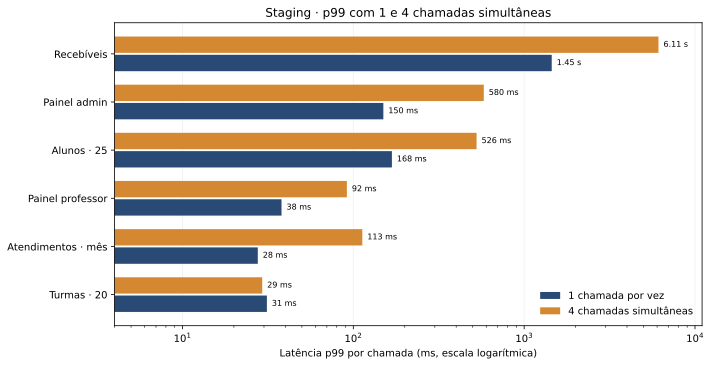
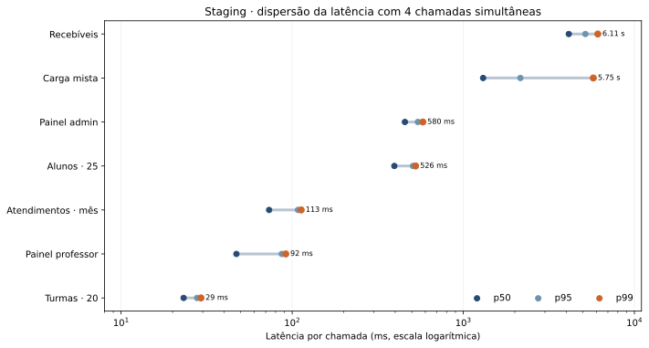
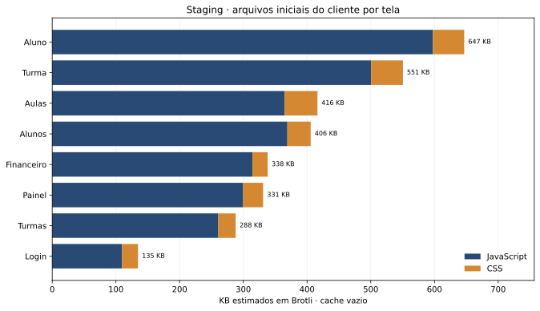
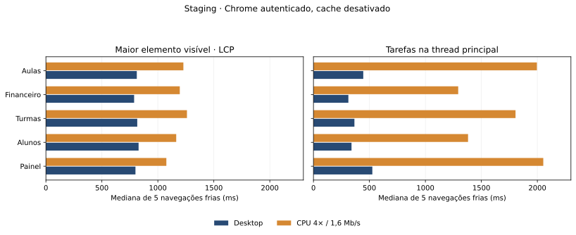

# Benchmark geral em staging — 3 de novembro de 2026

## Escopo e método

- Ambiente: versão **implantada** em staging, EC2 `t4g.small`, PostgreSQL RDS `db.t4g.micro`. O banco é compartilhado com produção; métricas de infraestrutura não isolam as duas cargas.
- Servidor: chamadas de leitura via tRPC `createCaller` dentro do contêiner do worker, sem HTTP, autenticação, renderização Next.js ou trânsito de rede do navegador. São 100 amostras por fluxo com 1 chamada e 100 com 4 chamadas simultâneas, após duas chamadas de aquecimento. A mistura tem 200 amostras com concorrência 4. Pool limitado a 4 conexões; o papel de staging admite 10. Erros: zero nas corridas completas.
- Consultas: três chamadas adicionais por fluxo com eventos Prisma/Kysely, CPU do processo e `EXPLAIN (ANALYZE, BUFFERS)` em templates `SELECT` distintos. Eventos do cliente SQL incluem espera por conexão e transporte; seu tempo não é igual ao tempo de execução no PostgreSQL.
- Cliente: manifesto de referência do build Next.js implantado para estimar arquivos iniciais em cache vazio e compressão Brotli. Chrome 156 mediu cinco navegações novas por condição em `/login` e em cinco telas autenticadas, com cache desativado; “4G lento” aplica CPU 4× e rede 1,6 Mb/s. Os bytes reais incluem documento, fontes e outros recursos. A conta sintética de acesso foi excluída após o teste.
- Os dados são uma linha de base de staging. Alterações ainda não implantadas deste worktree não entram nos resultados.

## Latência de servidor

| Fluxo                 | p50 1 chamada | p99 1 chamada | p50 4 chamadas | p99 4 chamadas | Consultas por chamada |
| --------------------- | ------------: | ------------: | -------------: | -------------: | --------------------: |
| Painel administrativo |        119 ms |        150 ms |         456 ms |         580 ms |                    90 |
| Alunos, página de 25  |        109 ms |        168 ms |         395 ms |         527 ms |                    93 |
| Turmas, página de 20  |          7 ms |         31 ms |          23 ms |          29 ms |                    11 |
| Resumo de recebíveis  |      1.022 ms |      1.450 ms |       4.137 ms |   **6.113 ms** |                    11 |
| Atendimentos do mês   |         19 ms |         28 ms |          73 ms |         113 ms |                    36 |
| Painel do professor   |         14 ms |         38 ms |          47 ms |          92 ms |                    27 |

A mistura de seis fluxos com quatro chamadas simultâneas teve p50 de 1.305 ms, p95 de 2.156 ms e p99 de 5.753 ms; completou 200 chamadas em 63,6 s (3,14 chamadas/s). O resumo de recebíveis sozinho levou 105,2 s com concorrência 1 e 105,7 s com concorrência 4 para as mesmas 100 chamadas: concorrência aumentou a espera sem elevar o throughput, compatível com saturação de CPU do processo.

## Onde está o custo

1. **Recebíveis: CPU no código de composição.** Três perfis da chamada usaram 1,22–1,49 s de CPU cada, contra 87–123 ms somados nos 11 eventos de consulta. [`loadActiveOrderInstallments`](../../packages/api/src/finance/internal/ledger-read.ts) lê aproximadamente 3.528 parcelas, 1.465 ajustes e 1.489 alocações, então percorre todos os ajustes e alocações novamente para **cada** parcela (`filter` dentro de `map`). É uma inferência sustentada pelos tempos e pelo código; o próximo ganho provável é agrupar os filhos por `installmentId` em mapas antes de montar as parcelas.
2. **Alunos: consultas crescem com o tamanho da página.** Página de 10: 54 consultas; 25: 93; 50: 153, em cada uma das três repetições. [`readAttendanceByStudent`](../../packages/api/src/students/list.ts) chama o cálculo de frequência por aluno. Essa relação comprova N+1 no fluxo medido. É candidato a agregação em lote, preservando a regra de janela do semestre.
3. **Painel administrativo: fan-out.** São 90 consultas por chamada. [`readHomeGroups`](../../packages/api/src/dashboard/home.ts) dispara diversas leituras para grupos e históricos. O custo observado é a quantidade de consultas/espera, sem evidência de uma única consulta SQL lenta nesse fluxo.

### Consultas SQL mais caras entre os templates medidos

Dos 172 templates `SELECT`, 164 tiveram plano válido. Oito falharam ao reproduzir parâmetros de data/hora do Prisma (`22007`); nenhum desses oito entra no ranking abaixo. `EXPLAIN ANALYZE` executou os templates com parâmetros capturados e mediu o executor no banco, em cache quente.

| Tabelas principais        | Execução no PostgreSQL | Blocos compartilhados lidos do disco | Blocos encontrados no cache | Linhas no nó raiz |
| ------------------------- | ---------------------: | -----------------------------------: | --------------------------: | ----------------: |
| ClassSession + Attendance |                3,76 ms |                                    0 |                         206 |                19 |
| Installment + Order       |                1,82 ms |                                    0 |                          69 |             3.528 |
| PaymentAllocation         |                0,71 ms |                                    0 |                          26 |             1.489 |
| InstallmentAdjustment     |                0,69 ms |                                    0 |                          29 |             1.465 |

No volume atual, a consulta isolada mais lenta ainda ficou abaixo de 4 ms de execução no banco. As leituras de parcelas e filhos retornam milhares de linhas e podem piorar com o crescimento. O banco tinha 9.756 presenças, 3.528 parcelas e 1.793 aulas. `pg_stat_statements` não estava instalado e Performance Insights estava desativado; este ranking é das chamadas observadas, não do histórico completo da aplicação.

O primeiro teste sem limite explícito de pool encontrou `P2037` (“Too many database connections opened”) com quatro chamadas paralelas. O papel de staging tem limite de 10 conexões. Com pool de quatro, o benchmark completo não teve erros. Durante a carga, a CPU RDS ficou em aproximadamente 8–18% na amostragem de um minuto; a EC2 chegou a ~48% em média e ~70% no máximo em um minuto. Durante uma coleta **adicional** de planos, após o benchmark concluído, o kernel registrou falta de memória na EC2 de 2 GiB e encerrou o processo web. A coleta foi cancelada. O log não identifica qual processo consumiu a memória decisiva, e essa carga diagnóstica não representa uma navegação comum. O script agora exige `--explain` para executar os planos e define timeout de 500 ms por statement. O evento revela pouca folga operacional no host; não prova que uma consulta específica ou o uso cotidiano causem a mesma queda.

Após parar e iniciar somente a EC2 de staging, `/login` voltou a responder HTTP 200 e os cinco contêineres ficaram ativos. Depois das 50 navegações autenticadas, sem carga diagnóstica simultânea, o web usava 667 MiB, o worker 424 MiB e o host tinha 351 MiB de memória disponível, sem swap. Logo após o boot, eram 279 MiB no web e 677 MiB disponíveis. Essa variação pode incluir cache e aquecimento do Next.js; não prova vazamento, mas confirma que tráfego comum pode reduzir bastante a folga antes de um pico.

Produção roda em **outra EC2**, também `t4g.small`. Uma leitura pontual, sem gerar carga, mostrou 555 MiB disponíveis, web em 265 MiB e worker em 451 MiB, também sem swap. Esse retrato não prevê um pico futuro, mas confirma que o incidente de staging não consumiu a RAM da máquina de produção.

## Peso do cliente

| Tela             | JavaScript Brotli estimado | CSS Brotli estimado | Total inicial estimado |
| ---------------- | -------------------------: | ------------------: | ---------------------: |
| Login            |                     112 KB |               25 KB |                 135 KB |
| Turmas           |                     267 KB |               28 KB |                 288 KB |
| Painel           |                     307 KB |               32 KB |                 331 KB |
| Financeiro       |                     322 KB |               24 KB |                 338 KB |
| Alunos           |                     378 KB |               37 KB |                 406 KB |
| Aulas            |                     365 KB |               52 KB |                 416 KB |
| Detalhe da turma |                     513 KB |               50 KB |                 551 KB |
| Perfil do aluno  |                 **612 KB** |               50 KB |             **647 KB** |

São estimativas de arquivos iniciais do manifesto, não bytes transferidos em uma visita real nem custo de execução. O perfil do aluno importa diversas seções e diálogos diretamente; é o maior candidato de produto para divisão de JavaScript por tela/aba. A prévia dessa página também possui espera deliberada de 1,8 s; não foi medida como desempenho de rede ou CPU.

Na medição real de `/login`, a mediana no desktop foi LCP 916 ms, DOMContentLoaded 897 ms, 608 KB transferidos e 201 ms de tarefas na thread principal. Com CPU 4× mais lenta e rede 1,6 Mb/s, LCP foi 1.128 ms e tarefas somaram 1.180 ms. Cada condição tem cinco amostras; são números de laboratório desta máquina e rede, não Core Web Vitals de usuários.

| Tela autenticada | Transferência real, desktop | JS real, desktop | LCP desktop | Tarefas desktop | LCP CPU 4× / 1,6 Mb/s | Tarefas CPU 4× / 1,6 Mb/s |
| ---------------- | --------------------------: | ---------------: | ----------: | --------------: | --------------------: | ------------------------: |
| Painel           |                      953 KB |           652 KB |      800 ms |          526 ms |              1.076 ms |              **2.053 ms** |
| Alunos           |                      810 KB |           730 KB |      828 ms |          340 ms |              1.164 ms |                  1.381 ms |
| Turmas           |                      694 KB |           590 KB |      816 ms |          366 ms |              1.260 ms |                  1.805 ms |
| Financeiro       |                      563 KB |           509 KB |      788 ms |          312 ms |              1.196 ms |                  1.293 ms |
| Aulas            |                      857 KB |       **735 KB** |      812 ms |          445 ms |              1.228 ms |                  1.996 ms |

Cada célula é a mediana de cinco navegações frias. Os bytes efetivos de JavaScript são maiores que a estimativa inicial do manifesto porque o navegador pode carregar outros chunks e usar outra codificação de transferência. LCP mede o maior elemento pintado, **não** garante que os dados da tela estejam prontos; prontidão funcional e INP não foram medidos. O volume de JS e o tempo de tarefas sob CPU lenta indicam custo relevante no cliente, sobretudo em painel, aulas e alunos.

## Próximas verificações

- Implementar o agrupamento de ajustes/alocações por parcela e comparar p50/p99 antes e depois no mesmo ambiente.
- Agregar frequência dos alunos em lote, então repetir as páginas de 10/25/50 para confirmar que a contagem de consultas deixa de crescer com as linhas.
- Medir prontidão dos dados e resposta à interação nas telas autenticadas, pois LCP sozinho não responde a essas perguntas.

Dados sem parâmetros SQL, tokens ou informações pessoais: [servidor](staging-general-2026-11-03.json), [consultas](staging-query-profile-2026-11-03.json), [manifesto](staging-client-bundles-2026-11-03.json), [navegador público](staging-client-browser-2026-11-03.json) e [navegador autenticado](staging-client-auth-browser-2026-11-03.json). Scripts: [`benchmark-staging-general.mts`](../../scripts/benchmark-staging-general.mts), [`measure-staging-client-bundles.mjs`](../../scripts/measure-staging-client-bundles.mjs), [`measure-staging-client.mjs`](../../scripts/measure-staging-client.mjs) e [`plot-staging-performance.py`](../../scripts/plot-staging-performance.py).
